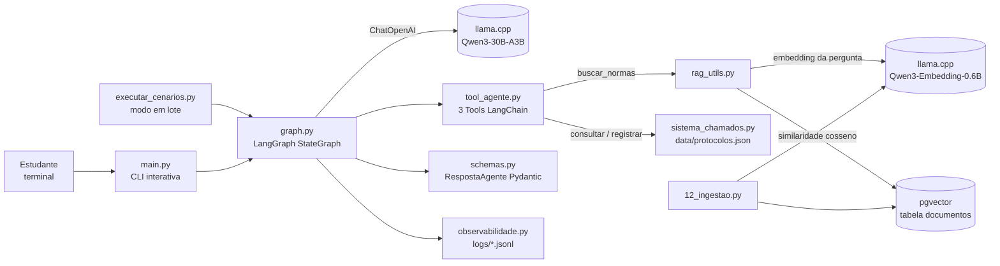
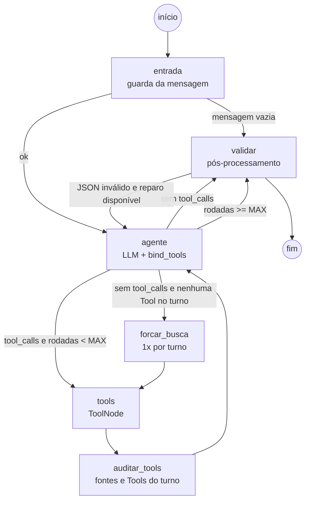

# 03 — Plan

> Etapa 3 do fluxo SDD: Intent → Spec → **Plan** → Tasks → Implement/Test/Validate.
> Define *como* os requisitos de `02_spec.md` serão atendidos: arquitetura, fluxo, módulos e decisões.

## 1. Modalidade de execução

**Modalidade E — stack totalmente local** (enunciado, seção 3).

- Backend: Python 3.12+ em venv, executado no terminal (sem API HTTP, sem frontend).
- Serviços locais via Docker Compose: LLM, embeddings e pgvector.
- Nenhuma chave de API externa (RNF-01).

## 2. Arquitetura

Separação exigida pelo enunciado: **modelo** (`llm.py`), **recuperação** (`rag_utils.py`),
**Tools** (`tool_agente.py`), **fluxo** (`graph.py`) e **validação** (`schemas.py` + nó `validar`).

## 3. Fluxo do agente (StateGraph)

### 3.1 Estado explícito (`EstadoAgente`, TypedDict)

| Campo | Tipo | Uso |
|---|---|---|
| `messages` | `Annotated[list, add_messages]` | Histórico da execução |
| `pergunta` | `str` | Mensagem original do estudante |
| `intencao_registro` | `bool` | Calculado no nó `entrada`; lido pela Tool de ação (RF-04) |
| `rodadas` | `int` | Contador de passagens pelo nó `agente` (RNF-04) |
| `fontes_recuperadas` | `list[str]` | IDs `ACAD-xxx` devolvidos por `buscar_normas` nesta execução |
| `tools_executadas` | `list[dict]` | Nome, argumentos não sensíveis e status de cada chamada |
| `tentativas_reparo` | `int` | Reparos de schema já feitos (máx. 1) |
| `resposta_final` | `RespostaAgente \| None` | Saída validada |
| `motivo_termino` | `str` | `resposta_final`, `limite_rodadas`, `mensagem_vazia`, `erro_llm`, `erro_schema` |

### 3.2 Nós

| Nó | Responsabilidade | Requisitos |
|---|---|---|
| `entrada` | Rejeita mensagem vazia/só espaços; detecta **intenção explícita de registro** por padrões verbais na mensagem atual (`abra`, `abrir`, `registre`, `registrar`, `quero abrir`, `solicito a abertura`…); registra o evento. | RF-04, RNF-05 |
| `agente` | Chama o LLM com system prompt + Tools; incrementa `rodadas`; captura timeout/conexão e encerra com `erro`. | RF-01..07, RNF-05 |
| `tools` | `ToolNode` com as 3 Tools; `handle_tool_errors` transforma Tool desconhecida ou argumento inválido em mensagem de erro para o modelo. | RNF-09 |
| `auditar_tools` | Lê o resultado de cada Tool do turno, atualiza `fontes_recuperadas` e `tools_executadas` e registra o evento `tool` no log. *(Acrescentado na implementação: o `ToolNode` só devolve mensagens, e o nó `validar` precisa desses dados no estado.)* | RNF-06, RF-01 |
| `forcar_busca` | **Controle de grounding** *(acrescentado após a 2ª execução, ADR-08)*: se o agente tenta responder sem ter executado nenhuma Tool no turno, descarta essa resposta (`RemoveMessage`) e chama `buscar_normas` com a pergunta do estudante (senhas mascaradas). No máximo uma vez por turno. | RF-01, RF-02 |
| `validar` | **Nó real de pós-processamento:** converte a resposta em `RespostaAgente`, aplica as invariantes da Spec 3.5, remove fontes não recuperadas, corrige status incoerente com as Tools executadas e grava o término. | RNF-02, RF-01..03 |

### 3.3 Roteamento condicional

- Após `entrada`: mensagem vazia → `validar` (status `erro`); senão → `agente`.
- Após `agente`: com `tool_calls` e `rodadas < MAX_RODADAS` → `tools`; com `tool_calls` e limite atingido → `validar` (`motivo_termino = limite_rodadas`); sem `tool_calls` → `validar`.
- Após `validar`: JSON inválido e `tentativas_reparo == 0` → volta ao `agente` com instrução de correção; senão → `END`.
- Proteção extra: `recursion_limit` do LangGraph = `2 * MAX_RODADAS + 6`.

### 3.4 Autorização da Tool de ação

`registrar_solicitacao` recebe `intencao_registro` via `InjectedState` (não exposto ao LLM).
Sem intenção explícita, a Tool **não persiste** e retorna `{"status": "bloqueado"}` — a trava fica
no código, não apenas no prompt (ADR-05). Depois valida os campos obrigatórios do tipo (Spec 3.4)
e retorna `dados_pendentes` quando faltar algo.

## 4. Recuperação (RAG)

- **Tabela** `documentos(id TEXT PK, titulo TEXT, categoria TEXT, conteudo TEXT, embedding vector(1024))`.
- **Ingestão** (`12_ingestao.py`): lê `data/base_conhecimento_academica.json`, gera o embedding de
  `titulo + conteudo` e faz *upsert* por `id` (idempotente). Indexa os **12** documentos.
- **Consulta** (`rag_utils.buscar_contexto`): embedding da pergunta com o mesmo modelo, prefixado pela
  instrução de consulta recomendada para o Qwen3-Embedding; `ORDER BY embedding <=> query LIMIT TOP_K`;
  devolve `fonte, titulo, categoria, trecho, score` (score = 1 − distância cosseno).
- **Abstenção (RF-02):** evidências com `score < SCORE_MINIMO` são descartadas; sem evidência, a Tool
  devolve `sem_evidencia`. O limiar é calibrado com `13_busca_semantica.py` sobre os 10 cenários e a
  calibração fica registrada em `05_validacao.md`.
- Filtro opcional por `categoria` (metadado).

## 5. Saída estruturada

O system prompt pede que a resposta final seja um JSON `{resposta, status, fontes, protocolo}`.
O nó `validar`:

1. tenta `RespostaAgente.model_validate_json(conteudo)`;
2. se falhar, faz **um** reparo: volta ao `agente` pedindo só o JSON (contado em `rodadas`);
3. se falhar de novo, usa o texto livre do modelo com o status **derivado das Tools executadas**
   (correção registrada); sem texto, `status = erro`. Se nem assim o contrato for satisfeito,
   `motivo_termino = erro_schema`;
4. aplica as invariantes (Spec 3.5) **sempre**, mesmo com JSON válido.

**Memória da conversa:** o grafo usa `InMemorySaver` por `thread_id` (uma sessão do terminal ou um cenário).
Os campos do turno (rodadas, fontes, Tools, resposta) são zerados no nó `entrada`. Se o turno anterior
terminou em `dados_pendentes`, a próxima mensagem conta como continuação do pedido de registro
(o estudante informa a turma sem repetir "abra uma solicitação").

## 6. Observabilidade

`observabilidade.py` grava um arquivo JSON Lines por execução em `logs/` com os eventos:
`inicio`, `entrada`, `decisao_agente` (Tools escolhidas e argumentos), `tool` (resultado resumido,
duração, erro), `validacao` (correções aplicadas), `fim` (status, rodadas, motivo do término).
Uma função `mascarar()` substitui padrões de senha, token e chave antes de gravar (RNF-06, CA-11).

## 7. Mapa de módulos

Os nomes dos arquivos reaproveitados das aulas foram mantidos para evidenciar o reuso.

| Arquivo | Origem | Papel no trabalho |
|---|---|---|
| `settings.py` | aula pinecone | Configuração via `.env`: provedor local, URLs, `TOP_K`, `SCORE_MINIMO`, `MAX_RODADAS`, caminhos. Sai o Pinecone |
| `llm.py` | aula pinecone | `criar_modelo()` (ChatOpenAI → llama.cpp) e cliente de embeddings |
| `rag_utils.py` | aula 20260926 | Embeddings + busca no pgvector com metadados e score |
| `12_ingestao.py` | aula 20260926 | Indexação idempotente dos 12 documentos |
| `13_busca_semantica.py` | aula 20260926 | Busca sem LLM: evidência de retrieval e calibração do limiar |
| `sistema_chamados.py` | aula pinecone | Protocolos `SOL-xxxx` em `data/protocolos.json`, dados iniciais, tipos e validação |
| `tool_agente.py` | aula pinecone | `buscar_normas`, `consultar_protocolo`, `registrar_solicitacao` com `args_schema` Pydantic |
| `graph.py` | aula pinecone | `EstadoAgente`, nós, roteamento e limite de rodadas |
| `00_testar_llm.py` | aula pinecone | Teste rápido de conexão e Tool Calling |
| `sql/init.sql` | aula 20260926 | Extensão `vector` + tabela `documentos` |
| `schemas.py` | novo | `RespostaAgente`, argumentos das Tools, `Protocolo` |
| `prompts.py` | novo | System prompt do agente |
| `observabilidade.py` | novo | Logger JSONL e `mascarar()` |
| `main.py` | novo | CLI interativa |
| `executar_cenarios.py` | novo | Roda T01–T10, compara com o esperado e grava `resultados/` |
| `data/esperado_cenarios.json` | novo | Resultado esperado de cada cenário (Spec 4.2), sem alterar as perguntas |
| `compose.yaml` | novo (substitui `docker-compose.rag.yml`) | `llm`, `embeddings` e `pgvector` |
| `tests/` | novo | Testes com modelo simulado (sem LLM real) |
| `.env.example`, `README.md`, `RELATORIO.md`, `USO_DE_IA.md` | novos | Entregáveis |

## 8. Infraestrutura local (`compose.yaml`)

| Serviço | Imagem | Porta (host) | Função |
|---|---|---|---|
| `llm` | llama.cpp server (digest fixado) | `127.0.0.1:8091` | `Qwen3-30B-A3B-Instruct-2507-UD-Q2_K_XL.gguf`, `--jinja` (Tool Calling), contexto 16k |
| `embeddings` | llama.cpp server (mesmo digest) | `127.0.0.1:8092` | `Qwen3-Embedding-0.6B-Q8_0.gguf`, `--embedding --pooling last` (1024 dimensões) |
| `pgvector` | `pgvector/pgvector:0.8.6-pg17` | `127.0.0.1:5434` | Banco `horizonte`, `sql/init.sql` na inicialização |

- Os modelos ficam em `${MODELOS_DIR:-./modelos}`, montado somente leitura. O README traz os comandos
  para baixar os GGUF; localmente `MODELOS_DIR` aponta para os modelos já baixados, sem duplicar ~12 GB.
- Portas e nomes diferentes dos de outros projetos locais para evitar conflito. Com 18 GB de RAM,
  **apenas um** servidor do modelo 30B deve estar ativo por vez (o README avisa).
- O Python roda no venv do host; o Compose sobe só os serviços.

## 9. Testes

| Nível | Como | Requisitos |
|---|---|---|
| Unitário | `pytest`: validação de argumentos, protocolos (consulta, registro, pendências, persistência em arquivo temporário), `mascarar()`, invariantes da `RespostaAgente` | RF-03..05, RNF-02, RNF-06, RNF-09 |
| Grafo | `pytest` com **modelo simulado** que devolve `tool_calls` roteirizados: roteamento, limite de rodadas, bloqueio sem intenção, reparo de schema, erro do LLM | RNF-04, RNF-05, RNF-08 |
| Integração real | `executar_cenarios.py` com os serviços locais: T01–T10, logs e `resultados/` | todos os CA |

## 10. Decisões técnicas (ADRs)

| ID | Decisão | Alternativas consideradas | Motivo |
|---|---|---|---|
| **ADR-01** | Stack 100% local com **llama.cpp** servindo API compatível com OpenAI | Groq/Gemini + Pinecone (cloud); LocalAI | Sem chave nem cota; llama.cpp é mais leve que o LocalAI e já foi validado nesta máquina; a API OpenAI permite reaproveitar o `ChatOpenAI` da aula sem mudar o grafo |
| **ADR-02** | LLM **Qwen3-30B-A3B-Instruct-2507 (Q2_K_XL)** | qwen3-4b; qwen3 0.6b/1.7b | Arquitetura MoE com ~3B parâmetros ativos: velocidade por token próxima de um modelo pequeno com qualidade de um maior. Modelos pequenos falharam em usar o retorno das Tools nos testes da aula. Custo: ~12 GB de RAM. Plano B: qwen3-4b trocando só o `.env` |
| **ADR-03** | **pgvector com SQL próprio**, encapsulado numa Tool LangChain | Chroma; `langchain-postgres` | Reaproveita o código da aula; controle direto do score para a abstenção; metadados em colunas; menos dependências |
| **ADR-04** | Protocolos em **arquivo JSON** com escrita atômica | Tabela no Postgres; SQLite | Reaproveita `sistema_chamados.py`; arquivo legível como evidência; escrita em arquivo temporário + `rename` evita corromper o JSON |
| **ADR-05** | **Trava de ação no código** (`InjectedState` + validação de campos), além do prompt | Confiar só no system prompt; flag no `.env` (versão da aula) | Modelos locais podem desobedecer o prompt ou sofrer *prompt injection*; defesa em camadas atende RF-04/RF-06 de forma verificável |
| **ADR-06** | Saída estruturada por **JSON no texto final + Pydantic + 1 reparo** | `with_structured_output` em toda resposta | Evita uma chamada extra ao LLM por pergunta (CPU lenta); o reparo e o fallback demonstram o tratamento de falha de schema |
| **ADR-07** | Abstenção por **limiar de score + invariantes** no nó `validar` | Deixar só o LLM decidir | O LLM tende a responder mesmo com evidência fraca (T09); o limiar e as invariantes tornam a abstenção verificável |
| **ADR-08** | **Busca obrigatória imposta pelo grafo** (nó `forcar_busca`) e checagem de códigos ACAD no texto da resposta *(decisão tomada após a 2ª execução)* | Só reforçar o prompt; `tool_choice="required"` na 1ª rodada | Nas execuções reais o modelo pulou a busca em T06 (1ª e 2ª) e T08 (2ª), mesmo com temperatura 0 e regra explícita no prompt, e citou no texto uma fonte não recuperada. `tool_choice="required"` foi testado e descartado: no llama.cpp a geração restrita disparou (>1.200 tokens a ~4 tokens/s) até o timeout. O nó determinístico garante evidência sem depender do modelo |

## 11. Riscos e mitigação

| Risco | Impacto | Mitigação |
|---|---|---|
| Lentidão do 30B em CPU | Cenários demoram minutos | `MAX_RODADAS` baixo, contexto enxuto (Top-K 3), execução em lote em segundo plano |
| Modelo não chama a Tool ou inventa | Falha em T01–T09 | Prompt com regras explícitas; nó `validar` remove fontes não recuperadas e rebaixa para `abstencao` |
| Limiar de score mal calibrado | Abstenção indevida ou resposta sem base | Calibração documentada com os 10 cenários; limiar no `.env` |
| Falta de RAM com outros serviços ativos | Container encerrado (OOM) | README orienta parar outros servidores de modelo; healthchecks no Compose |
| JSON final malformado | Resposta perdida | Reparo único + fallback com `status = erro` registrado |
| Detecção de intenção por padrões falhar | Registro bloqueado ou indevido | Padrões testados em unidade; o bloqueio é o comportamento seguro padrão |

## 12. Rastreabilidade Spec → Plan

| Requisito | Onde é atendido |
|---|---|
| RF-01 | `buscar_normas`, `prompts.py`, nó `validar` (fontes ⊆ recuperadas) |
| RF-02 | `SCORE_MINIMO` em `rag_utils.py`, invariante `abstencao` (ADR-07) |
| RF-03 | `consultar_protocolo`, `sistema_chamados.py`, invariante `protocolo_consultado` |
| RF-04 | nó `entrada` (intenção) + `InjectedState` em `registrar_solicitacao` (ADR-05) |
| RF-05 | validação por tipo em `sistema_chamados.py`, status `dados_pendentes` |
| RF-06 | `prompts.py`, ausência de Tool de alteração, trava da Tool de ação |
| RF-07 | `prompts.py`, rejeição de argumentos com aparência de credencial, `mascarar()` |
| RF-08 | `main.py`, `executar_cenarios.py` |
| RNF-01 | `compose.yaml`, `settings.py` (ADR-01, ADR-02) |
| RNF-02 | `schemas.py`, nó `validar` (ADR-06) |
| RNF-03 | `12_ingestao.py`, `rag_utils.py`, `TOP_K` |
| RNF-04 | `MAX_RODADAS`, roteamento, `recursion_limit` |
| RNF-05 | nós `entrada`/`agente`/`validar`, tratamento de erros nas Tools |
| RNF-06 | `observabilidade.py` |
| RNF-07 | `README.md`, `.env.example`, `compose.yaml` |
| RNF-08 | `tests/`, `executar_cenarios.py` |
| RNF-09 | `ToolNode` com `handle_tool_errors`, `args_schema` Pydantic |
